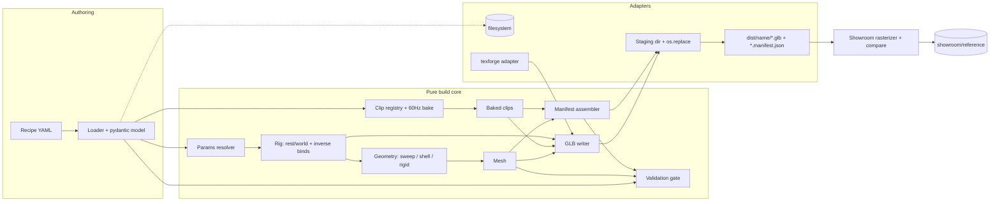

# Architecture

beastforge is a single Python CLI package with a hard boundary between a **pure
build core** and **adapters** that touch the filesystem, environment, or
texforge. The four accepted ADRs are the design law:

- [ADR 261114-1](../../_ai/technical_decisions/ADR__261114-1__gltf-manifest-contract.md):
  glTF 2.0 plus a sidecar manifest.
- [ADR 261114-2](../../_ai/technical_decisions/ADR__261114-2__offline-deterministic-generator.md):
  offline, deterministic, texforge-shaped CLI.
- [ADR 261114-3](../../_ai/technical_decisions/ADR__261114-3__construction-bound-skinning.md):
  skin weights fall out of surface construction.
- [ADR 261114-4](../../_ai/technical_decisions/ADR__261114-4__baked-joint-clips-and-event-frames.md):
  clips are baked at 60 Hz; manifest events are authoritative.

## Goals and boundaries

- One generation produces one `.glb` and one `.manifest.json`, committed as an
  atomic pair.
- Output bytes depend only on the recipe, the resolved parameters, and the tool
  version. No wall clock, locale, hostname, environment ordering, or unseeded
  randomness may reach geometry, clips, textures, or JSON.
- Recipes are inert data. They name clip generators from a closed registry and
  texforge recipes by name; they never execute code.
- Validation is a gate, not advice. A package cannot be committed if the gate
  would reject it.

## Components

| Module | Responsibility | IO? |
|--------|----------------|-----|
| `model/` | pydantic recipe, manifest, report, finding, and error models | no |
| `params.py` | declared knobs, coercion, ranges, suggestions | no |
| `rng.py` | SHA-256-derived seed streams | no |
| `rig/` | world rest transforms, inverse binds, joint-band weights | no |
| `geometry/` | swept tubes, torso shells, rigid parts, normals | no |
| `anim/` | closed generator registry, 60 Hz sampling, baked tracks | no |
| `export/` | deterministic GLB writer and manifest assembly | no |
| `validation/` | one ordered gate over skeleton, surfaces, skin, clips, hooks, materials, budgets, determinism | reads texforge recipe metadata only |
| `showroom/raster+compare+structural` | software rendering, perceptual comparison, structural summary | no |
| `pipeline.py` | pure orchestration of recipe → skeleton → mesh → clips | no |
| `render.py` | staging dir, texture rendering, atomic commit, report | yes |
| `texture/texforge_adapter.py` | the only texforge-aware module | yes |
| `library.py`, `config.py` | catalog scanning, name resolution, settings | yes |
| `cli/` | Typer grammar, streams, exit codes, error rendering | yes |

## Data flow and determinism

1. Load YAML with `yaml.safe_load`, reject executable keys/tags, validate the
   strict pydantic model.
2. Resolve declared parameters plus `--set` overrides.
3. Compute `recipe_sha256` from canonical JSON, then
   `run_seed = sha256("beastforge/v1:" + recipe_sha256 + ":" + canonical(params))`.
4. Build the skeleton, every surface, and every clip from the seed.
5. Render texforge textures in-process and embed the PNGs.
6. Assemble the canonical manifest.
7. Run the gate; only then write staged files and `os.replace` both into place.

Byte identity is enforced by golden tests, a 100-run determinism test, and a
two-working-directory comparison.

## Key trade-offs

- **Own numpy geometry and GLB writer** instead of a mesh library: full control
  of vertex/triangle/accessor order is the cheapest way to guarantee byte
  identity. `trimesh` is a dev-only independent consumer.
- **CPU software rasterizer** instead of OpenGL/EGL: no GPU, display server, or
  driver variation; the showroom stays offline and CI-friendly.
- **Construction-bound weights** instead of auto-skinning: weights are traceable
  to a recipe line and always inside the 4-influence glTF limit.
- **Baked clips** instead of runtime procedural animation: engines only need a
  standard glTF animation player; gameplay timing lives in the manifest.

## Further reading

- [API and JSON surfaces](api.md)
- [Recipe authoring](recipes.md)
- [Showroom and tolerance](showroom.md)
- [Development and release](development.md)
- Feature spec, plan, data model, and contracts under
  [specs/001-procedural-creature-generator/](../../specs/001-procedural-creature-generator/)
