# Showroom gallery

Every creature in the shipped library has an approved reference set under
[`showroom/reference/`](../showroom/reference). The showroom renders the current
build with fixed cameras and lighting and compares it against those references,
so this gallery is exactly what visual regression is protecting.

For the comparison rules and the accept workflow, see
[Showroom and visual regression](showroom.md).

## How the frames are made

Each creature is built through the normal pipeline and rasterized on the CPU by
`src/beastforge/showroom/raster.py`:

- Five RGBA frames per creature at `512 × 512`.
- Four fixed orthographic cameras: front, three-quarter, side, rear.
- One front frame is rerendered in an **extreme-bend** pose: a declared test
  joint is rotated 90° and the mesh is skinned, exposing shoulder/hip shearing.
- A z-buffer, one fixed key light plus ambient, two-sided Lambert shading, and
  nearest-neighbour texforge texture sampling.
- Transparent background (`alpha = 0`) on uncovered pixels.

No GPU, EGL, display server, or driver is involved, so the same frames render in
CI and offline.

## Regenerating this gallery

References only change through an explicit accept:

```bash
uv run beastforge showroom --accept
```

That rewrites `showroom/reference/<creature>/` with the newly rendered frames.
Commit the updated references and refresh the image links below in the same
change.

## ash-crowned-tyrant

Recipe: [`library/boss/ash-crowned-tyrant.yaml`](../library/boss/ash-crowned-tyrant.yaml)

**Turntable, rest pose**

| Front | Three-quarter | Side | Rear |
|:---:|:---:|:---:|:---:|
| 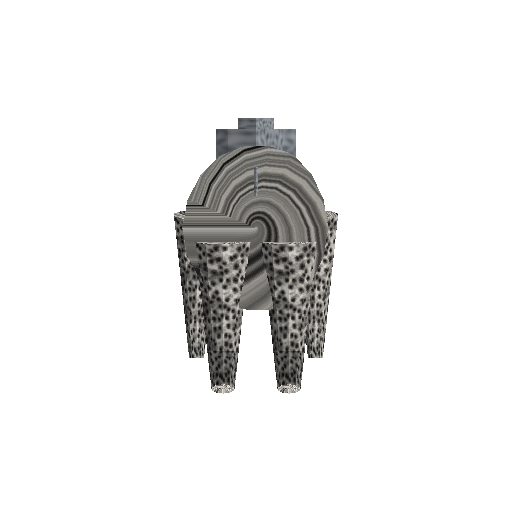 | 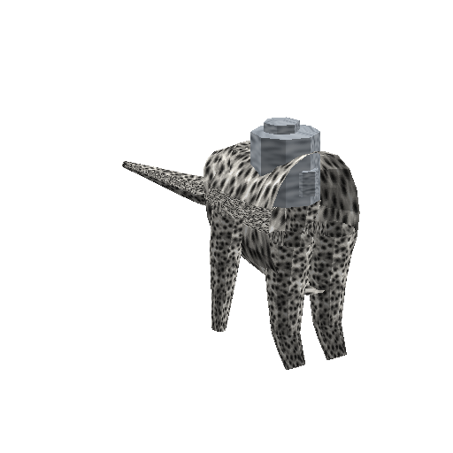 | 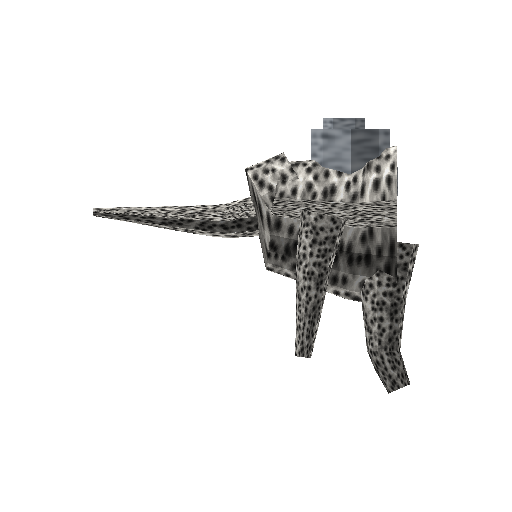 | 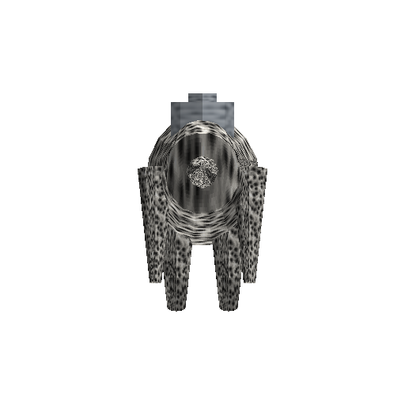 |

**Deformation check**

| Front, extreme bend (90°) |
|:---:|
| 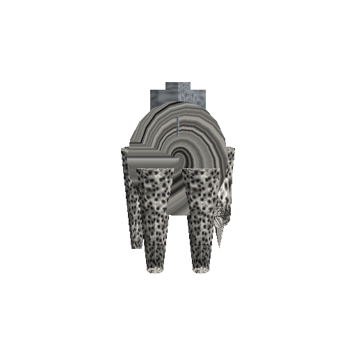 |

## ridge-stalker

Recipe: [`library/quadruped/ridge-stalker.yaml`](../library/quadruped/ridge-stalker.yaml)

**Turntable, rest pose**

| Front | Three-quarter | Side | Rear |
|:---:|:---:|:---:|:---:|
| 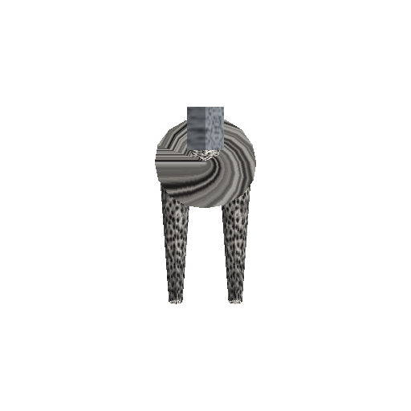 | 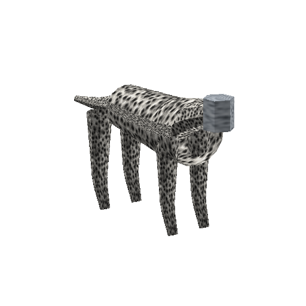 | 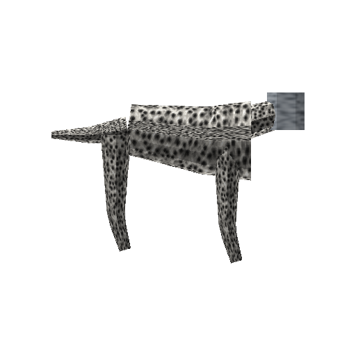 | 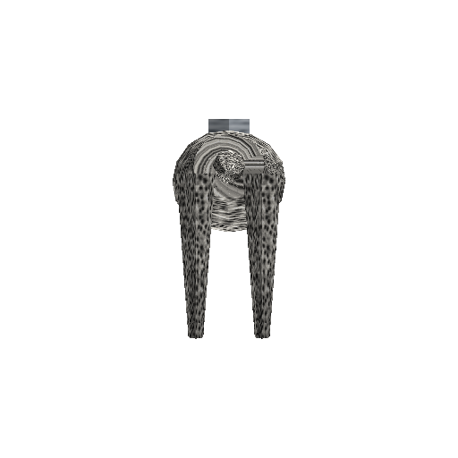 |

**Deformation check**

| Front, extreme bend (90°) |
|:---:|
| 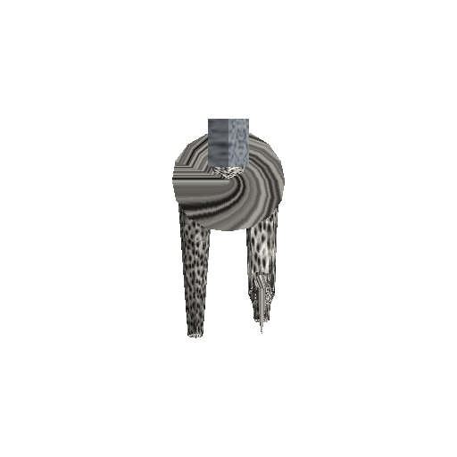 |

## elephant

Recipe: [`library/quadruped/elephant.yaml`](../library/quadruped/elephant.yaml)

**Turntable, rest pose**

| Front | Three-quarter | Side | Rear |
|:---:|:---:|:---:|:---:|
| 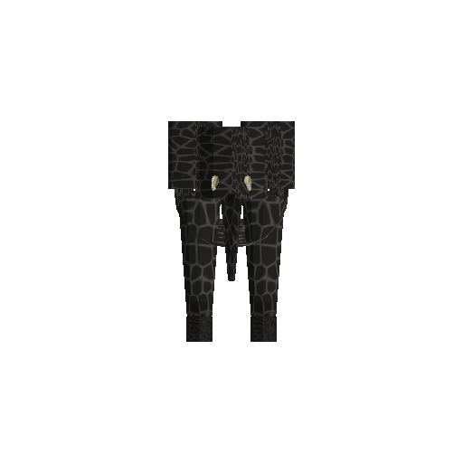 | 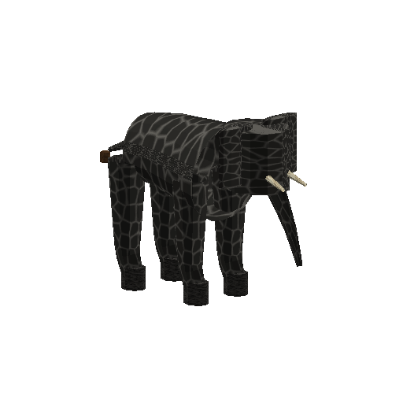 | 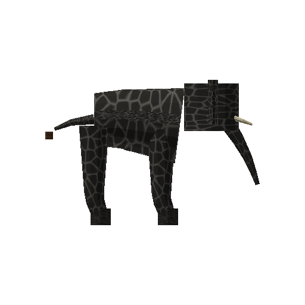 | 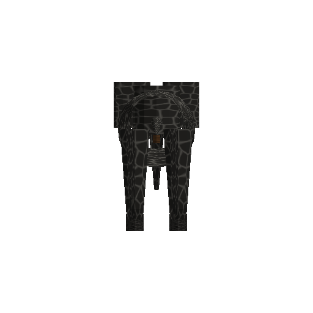 |

**Deformation check**

| Front, extreme bend (90°) |
|:---:|
| 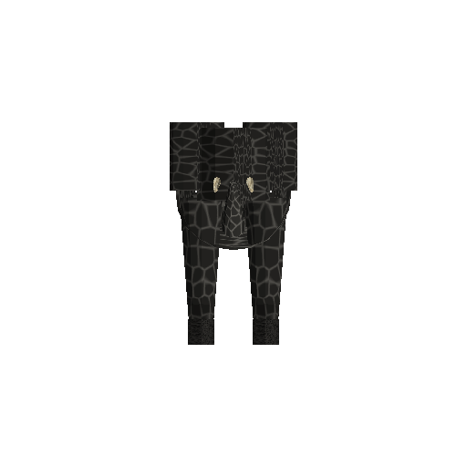 |

## giraffe

Recipe: [`library/quadruped/giraffe.yaml`](../library/quadruped/giraffe.yaml)

**Turntable, rest pose**

| Front | Three-quarter | Side | Rear |
|:---:|:---:|:---:|:---:|
| 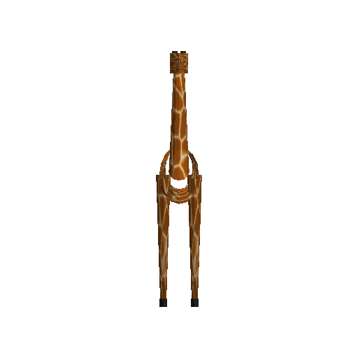 | 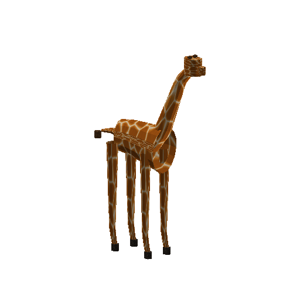 | 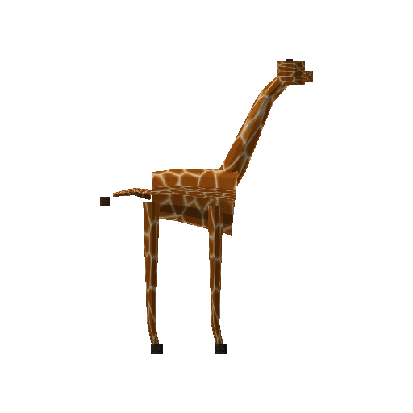 | 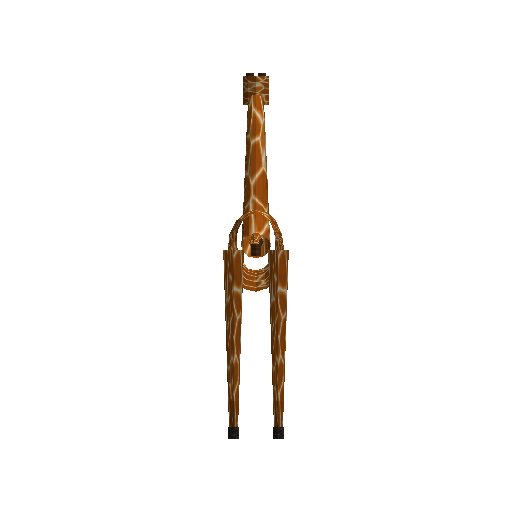 |

**Deformation check**

| Front, extreme bend (90°) |
|:---:|
| 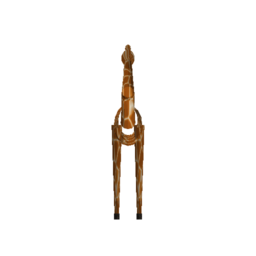 |

## chitter-mite

Recipe: [`library/swarm/chitter-mite.yaml`](../library/swarm/chitter-mite.yaml)

**Turntable, rest pose**

| Front | Three-quarter | Side | Rear |
|:---:|:---:|:---:|:---:|
| 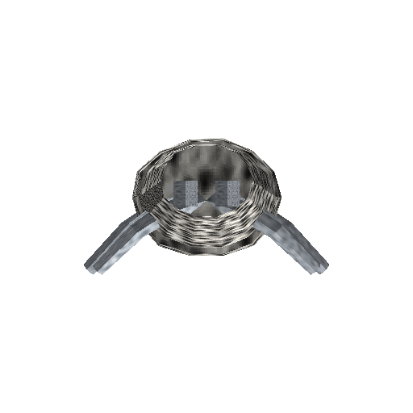 | 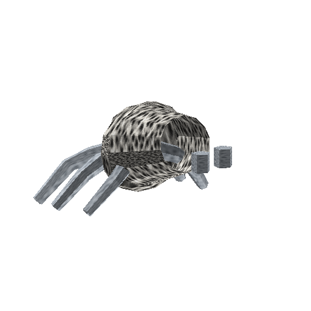 | 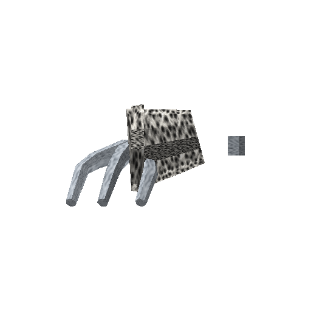 | 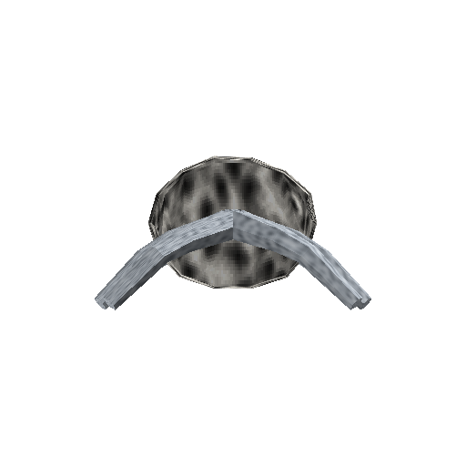 |

**Deformation check**

| Front, extreme bend (90°) |
|:---:|
| 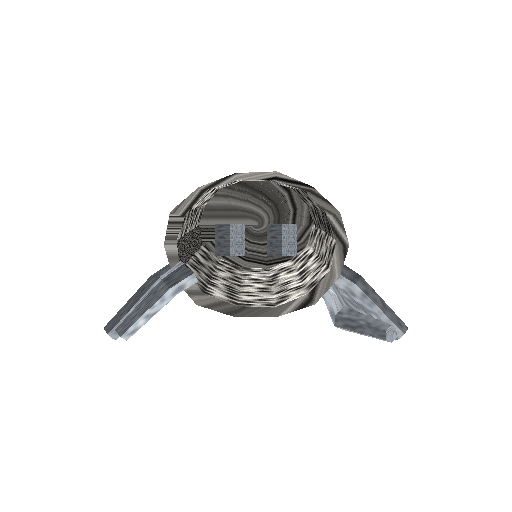 |
