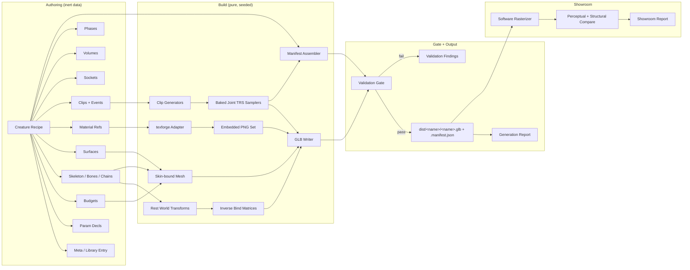

# Phase 1 Data Model: Procedural 3D Creature Generator (beastforge v1)

**Feature**: `001-procedural-creature-generator` | **Date**: 2026-11-14
**Inputs**: [spec.md](./spec.md), [research.md](./research.md), ADRs 261114-1/2/3/4

This file defines the entities the generator stores, builds, and emits, their
fields, the invariants that validation enforces, and the generation state
machine. Normative JSON shapes live in
[contracts/schema/](./contracts/schema/); the YAML authoring grammar is described
in [contracts/recipe-grammar.md](./contracts/recipe-grammar.md). Where this file
and a schema disagree, the schema wins and this file is corrected.

## Entity overview



## 1. Recipe document (authoring)

One YAML file per creature at `library/<category>/<name>.yaml`. Loaded with
`yaml.safe_load` only; the pydantic model forbids unknown keys.

| Field | Type | Required | Notes |
|-------|------|----------|-------|
| `meta` | Meta | yes | Catalog view of the recipe (see 2) |
| `params` | ParamDecl[] | yes (may be empty) | Declared knobs; defaults are part of the hash |
| `budgets` | Budgets | yes | Mesh/bone/clip ceilings (see 4) |
| `skeleton` | Skeleton | yes | Declared **before** surfaces conceptually (see 5) |
| `surfaces` | Surface[] | yes | At least one; binds to bones (see 6) |
| `materials` | MaterialRef[] | yes (may be empty) | texforge recipe references (see 7) |
| `clips` | ClipSpec[] | yes | Declared generators; reserved set required (see 8) |
| `sockets` | Socket[] | no | Optional attachment points (see 9) |
| `volumes` | Volume[] | yes | ≥1 `hit`; `weak-point`/`collision` optional (see 10) |
| `phases` | Phase[] | boss only | Required for `meta.category: boss` (see 11) |

**Invariants**
- `meta.category` is one of `boss`, `quadruped`, `swarm`, `other`.
- `meta.name` equals the file stem and matches `^[a-z0-9][a-z0-9-]*$`.
- No unknown top-level or nested keys (suggestion on error).
- No executable content: no custom YAML tags, no `eval`/`exec`/`import` keys.
- Every declared parameter used by the build must be declared in `params`;
  unused params are allowed but warned.

## 2. Meta and Library Entry

| Field | Type | Required | Notes |
|-------|------|----------|-------|
| `name` | string | yes | Stable identifier, `^[a-z0-9][a-z0-9-]*$`, ≤64 chars |
| `description` | string | yes | One line, catalog text |
| `category` | enum | yes | `boss` \| `quadruped` \| `swarm` \| `other` |
| `tags` | string[] | no | Lowercase tokens; duplicates rejected |
| `author` | string | no | Free text |
| `tested_with` | string | yes | Generator `MAJOR.MINOR.PATCH` this recipe was verified against |
| `version` | string | yes | Recipe's own SemVer; bump on behavioural edits |
| `units` | const `"m"` | no (default `m`) | Only metres supported in v1 |
| `orientation` | const | no | Defaults `{up: "Y", forward: "-Z"}`; any other value rejected |

**Library Entry** is a *view*, never a stored copy: `{name, category,
description, tags, params, tested_with, version, path}` produced by scanning
`library/*/*.yaml`. `path` is project-relative.

## 3. Param Decl

| Field | Type | Required | Notes |
|-------|------|----------|-------|
| `name` | string | yes | `^[a-z][a-z0-9-]*$` |
| `type` | enum | yes | `int` \| `float` \| `bool` \| `enum` \| `string` |
| `default` | scalar | yes | Must satisfy type/range |
| `min` / `max` | number | no | Inclusive; meaningful for int/float |
| `values` | scalar[] | enum only | Closed set |
| `unit` | string | no | `m`, `rad`, `deg`, `s`, `count`, `ratio` |
| `description` | string | yes | Shown by `params` |

**Invariants**: override keys must exist (else `recipe-unknown-param` with the
nearest valid name), values must coerce to the declared type and lie inside
limits (`recipe-param-type` / `recipe-param-range`). Floats are compared with a
`1e-9` tolerance to the declared bounds.

## 4. Budgets

| Field | Type | Default | Notes |
|-------|------|---------|-------|
| `vertices` | int | 20000 | Measured post-build; exceeded → `budget-exceeded` |
| `bones` | int | 64 | Skeleton joint count |
| `triangles` | int | 60000 | Derived from surfaces |
| `max_clip_ticks` | int | 600 | Per clip, at 60 Hz |

## 5. Skeleton, Bone, Chain

**Skeleton**: `{root: string, bones: Bone[], chains: Chain[]}`.

**Bone**:

| Field | Type | Required | Notes |
|-------|------|----------|-------|
| `name` | string | yes | Stable identifier, unique in the skeleton |
| `parent` | string \| null | yes | `null` only for the declared root |
| `rest` | Transform | yes | Translation (m), rotation (quaternion `[x,y,z,w]`), scale |
| `length` | number | no | Derived from rest translation when omitted; must be > 0 for limbs |

**Transform**: `{translation: [x,y,z], rotation: [x,y,z,w], scale: [x,y,z]}`,
rotations normalized, scale positive and non-zero.

**Chain**: `{name: string, bones: string[]}` — ordered, contiguous parent→child
bone names; consecutive entries must be parent/child, and the first bone's parent
must be the chain's attachment bone (declared by `parent` on the first bone).

**Invariants** (`validation/skeleton.py`)
- Exactly one `parent: null` bone, equal to `skeleton.root`.
- No cycles; every `parent` exists; every bone reachable from the root.
- Unique bone names.
- All rest transforms finite; rotations unit-length within `1e-6`; no inverted
  (negative determinant) or degenerate (zero scale, zero-length limb bone)
  transforms.
- Chains are ordered, non-empty, unique by name, and reference existing bones.
- World rest transforms are computed root→leaf in declaration order; inverse bind
  matrices are `inverse(world_rest)` in float64.

## 6. Surface

| Field | Type | Required | Notes |
|-------|------|----------|-------|
| `name` | string | yes | Unique per creature |
| `mode` | enum | yes | `sweep` (v1); anything else → `surface-unsupported-mode` |
| `kind` | enum | yes | `limb-tube` \| `torso-shell` \| `rigid-part` |
| `bones` | string[] | yes | Ordered binding bones; must exist and be contiguous in a chain |
| `rings` | int | no | Cross-section rings (limb: along bone; torso: around spine) |
| `segments` | int | no | Radial segments per ring |
| `radius` | RadiusProfile | yes | `{start, end}` or per-bone values; must be > 0 |
| `blend` | number | no | Joint band fraction, default `0.25`, clamped to `≤0.35·L` |
| `modifiers` | Modifiers | no | See below; all seeded and deterministic |
| `material` | string | no | Name of a `materials[]` entry |
| `rigid_bone` | string | rigid only | Exactly one bone; weight 1.0, no deformation |

**Modifiers** (FR-019): `taper` (start/end radius scale), `twist` (radians along
the sweep), `radial_noise` (`{amplitude, frequency, seed}`), `squash`
(`[sx, sy, sz]` per part), `scale` (per-part uniform or per-axis). Every
modifier resolves from declared params and the run seed only.

**Invariants** (`validation/skin.py`)
- Every vertex has 1–2 influences (≤4 hard limit), weights sum to `1.0 ± 1e-5`,
  and no vertex has zero total weight.
- Bind pose equals rest pose: exported inverse bind matrices match
  `inverse(world_rest)` within `1e-5`.
- UVs are emitted by construction (`U` along the sweep, `V` around); every
  triangle has consistent winding (outward normals).
- Cross-sections never self-intersect at the requested radius/segment count.
- Surface vertex count ≥ 3 and triangle count ≥ 1.
- Rigid parts have exactly one influence with weight 1.0.

## 7. Material Reference

| Field | Type | Required | Notes |
|-------|------|----------|-------|
| `name` | string | yes | Referenced by surfaces; unique |
| `texture` | string | yes | texforge recipe *name* (never a path) |
| `params` | map | no | texforge `--set` overrides; validated by texforge |
| `size` | string | no | `WxH`, default `512x512` |
| `slot` | enum | no | `baseColor` (default); v1 supports only baseColor |
| `metallic` / `roughness` | number | no | glTF scalar factors, default 0.0 / 0.8 |

**Invariants** (`validation/manifest_refs.py`): material names unique and
referenced by at least one surface; texforge recipe resolves; params valid;
rendered PNG is a valid PNG of the declared size; embedded image `sha256` is
recorded. A missing texture recipe fails **before** any asset is staged.

## 8. ClipSpec and Event

| Field | Type | Required | Notes |
|-------|------|----------|-------|
| `name` | string | yes | Unique; reserved set required (see below) |
| `generator` | enum | yes | Closed registry: `breathe`, `gait`, `hover-bob`, `recoil`, `telegraph-attack`, `death-collapse` |
| `params` | map | no | Generator-specific, validated against the registry |
| `duration` | number (s) | one of | Positive, ≤6 decimals |
| `ticks` | int | one of | 60 Hz; converted exactly (`s = ticks/60`) |
| `loop` | bool | yes | Loop clips carry a closing key at `t == duration` |
| `events` | Event[] | required for `attack` | See below |

**Event**: `{name, time | ticks}`. Names unique per clip; `0 <= time < duration`.
The `attack` clip MUST declare an event named `impact` (FR-025); additional events
(fire, footstep, death, phase-change) are allowed.

**Reserved core clips**: `idle`, `locomotion`, `attack`, `hurt`, `death`. All five
are required on every creature; extra clips are allowed with arbitrary names.

**Baked clip (runtime)**: `{name, duration, loop, generator, samplers[]}` where
each sampler targets one joint node and holds 60 Hz translation/rotation/scale
keys. Baked output is deterministic for the same recipe, params, and tool
version.

## 9. Socket

| Field | Type | Required | Notes |
|-------|------|----------|-------|
| `name` | string | yes | Unique, stable identifier |
| `bone` | string | yes | Must exist in the skeleton |
| `offset` | [x,y,z] | yes | Metres, in bone-local space |
| `node` | string | no | Reserved for later non-bone targets; rejected in v1 if set |

Sockets may be omitted entirely; when present, dangling targets fail validation
(FR-030, FR-036).

## 10. Volume

| Field | Type | Required | Notes |
|-------|------|----------|-------|
| `name` | string | yes | Unique |
| `role` | enum | yes | `hit` \| `weak-point` \| `collision` |
| `center` | [x,y,z] | yes | Metres, creature-local |
| `extents` | [x,y,z] | yes | Half-extents, all > 0 (box proxy) |
| `bone` | string | no | If set, volume follows that bone in-engine; must exist |

At least one `hit` volume is required on every creature (FR-025). `weak-point`
and `collision` are optional. No auto-derived fallback exists.

## 11. Phase

| Field | Type | Required | Notes |
|-------|------|----------|-------|
| `name` | string | yes | Unique |
| `threshold` | number | yes | `0 < threshold < 1`, fraction of max health |

Required for `meta.category: boss`; optional elsewhere; forbidden (rejected) on
non-boss categories only if declared inconsistently? — the rule is: boss recipes
MUST declare ≥1 phase; other categories MAY declare phases (they are validated
identically when present).

## 12. ResolvedRecipe (build input)

The pure, hashable build input: recipe document + resolved parameters + run
seed + tool version + texforge version. `recipe_sha256` is the SHA-256 of the
canonicalized recipe YAML document (sorted keys, UTF-8, LF). The run seed is
`sha256("beastforge/v1:" + recipe_sha256 + ":" + canonical(resolved_params))`.
Nothing else may influence geometry, ordering, or texture output.

## 13. Mesh (build output)

| Field | Type | Notes |
|-------|------|-------|
| `positions` | float64[N,3] | Creature-local, metres, Y-up, −Z forward |
| `normals` | float64[N,3] | Unit length, outward |
| `uv` | float64[N,2] | From sweep construction |
| `joints` | uint16[N,4] | 0–2 used; unused slots index joint 0 with weight 0 |
| `weights` | float64[N,4] | Normalized; used slots sum to 1.0 |
| `indices` | uint32[M,3] | Outward winding |
| `surfaces` | SurfaceRange[] | Name + vertex/index ranges, in recipe order |
| `bounds` | AABB | `{min:[x,y,z], max:[x,y,z]}` |

## 14. Manifest (emitted sidecar)

Canonical JSON; `schemaVersion` is `"MAJOR.MINOR"` (v1 starts at `"1.0"`).
Normative shape: [contracts/schema/manifest.schema.json](./contracts/schema/manifest.schema.json).

| Group | Fields |
|-------|--------|
| Identity | `schemaVersion`, `toolVersion`, `generator: "beastforge"`, `creature {name, category, description}` |
| Provenance | `provenance {recipePath, recipeSha256, recipeVersion, resolvedParams, texforgeVersion, toolVersion}` |
| Units | `units: "m"`, `upAxis: "Y"`, `forwardAxis: "-Z"`, `bounds`, `suggestedScale` |
| Rig | `skeleton {root, joints: [{name, parent}]}` |
| Clips | `clips[] {name, duration, loop, generator}` |
| Events | `events[] {clip, time, name}` — authoritative timing |
| Sockets | `sockets[] {name, target, offset}` |
| Volumes | `volumes[] {name, role, center, extents, bone?}` |
| Phases | `phases[] {name, threshold}` |
| Materials | `materials[] {name, slot, texture {recipe, params, size, sha256}, metallic, roughness}` |
| Playback | `playback.eventTimeScaling` — the "playback rate scales event times" warning |
| Budgets | `budgets {vertices, bones, triangles}` (measured values) |

**Invariants** (`validation/manifest_refs.py`): every event references an
existing clip; every socket references an existing joint; every volume `bone`
exists; every material referenced by a surface exists; all five reserved clips
are present; `schemaVersion` is well-formed; numbers finite. Consumers read
major-strict/minor-tolerant (`manifest-schema-unsupported` on a different major).

## 15. Generation Report (`render --json`)

| Field | Type | Notes |
|-------|------|-------|
| `schema_version` | const `"1"` | Report schema, not manifest schema |
| `tool_version` | string | SemVer of the generator |
| `status` | `"ok"` | Errors use the error schema |
| `dry_run` | bool | |
| `outputs` | object | `glb {path, sha256, bytes}`, `manifest {path, sha256, bytes}`, `textures[] {name, sha256, width, height}` |
| `inventory` | object | clips, events, sockets, volumes, phases |
| `effective_params` | map | Declared defaults merged with `--set` |
| `provenance` | object | recipe path, recipe sha256, tool version |
| `warnings` | string[] | Non-fatal advisories |
| `timing_ms` | number \| null | Diagnostic only, never part of byte identity |

Normative shape:
[contracts/schema/render.result.schema.json](./contracts/schema/render.result.schema.json).

## 16. Validation Finding

| Field | Type | Notes |
|-------|------|-------|
| `code` | string | Closed vocabulary (see below) |
| `severity` | enum | `error` \| `warning` |
| `location` | object | `{recipe, path}` where `path` is e.g. `surfaces[1].bones[2]` |
| `message` | string | What failed and why, plain language |
| `expected` | any | Expected value/shape |
| `actual` | any | Observed value/shape |
| `remedy` | string | Exact next step |

`validate --json` emits
[contracts/schema/validate.result.schema.json](./contracts/schema/validate.result.schema.json).

### Finding-code vocabulary (v1)

| Group | Codes |
|-------|-------|
| Recipe | `recipe-syntax`, `recipe-executable-content`, `recipe-unknown-field`, `recipe-unknown-param`, `recipe-param-type`, `recipe-param-range`, `recipe-name-invalid`, `recipe-unknown-param-suggestion` (warning) |
| Skeleton | `skeleton-root-missing`, `skeleton-root-multiple`, `skeleton-parent-missing`, `skeleton-cycle`, `skeleton-duplicate-bone`, `skeleton-unreachable-bone`, `skeleton-degenerate-transform`, `skeleton-inverted-transform`, `skeleton-zero-length-bone`, `chain-invalid`, `chain-duplicate` |
| Surfaces | `surface-unsupported-mode`, `surface-bone-missing`, `surface-empty`, `surface-self-intersection`, `surface-winding-invalid` |
| Skin | `skin-weight-sum`, `skin-too-many-influences`, `skin-zero-weight`, `skin-bind-pose-mismatch`, `skin-rigid-multi-influence` |
| Clips | `clip-missing-core`, `clip-duplicate`, `clip-unknown-generator`, `clip-nonpositive-duration`, `clip-fractional-ticks`, `clip-duration-over-budget`, `clip-event-duplicate`, `clip-event-negative-time`, `clip-event-out-of-range`, `clip-param-invalid` |
| Hooks | `volume-missing-hit`, `volume-duplicate`, `volume-role-invalid`, `phase-duplicate`, `phase-missing-for-boss`, `phase-threshold-range`, `socket-duplicate`, `socket-target-missing` |
| Materials | `material-duplicate`, `material-unresolved`, `material-param-invalid`, `material-size-invalid`, `material-not-referenced` (warning), `material-render-failed` |
| Budgets / names | `budget-exceeded`, `duplicate-name`, `identifier-invalid` |
| Determinism | `determinism-hazard`, `manifest-dangling-reference`, `manifest-core-clip-missing`, `manifest-schema-invalid`, `manifest-schema-unsupported` |

Warnings never change the exit code; errors do. New codes are additive; renaming
or removing a code is a major change to the validation contract.

## 17. Showroom Reference, Structural Summary, Showroom Report

**Reference set** (committed under `showroom/reference/<creature>/`):
`frames/<view>__<pose>.png` plus `structural.json`. A `manifest.json` records
tool version, camera/light settings hash, and the tolerance values used.

**Structural summary** (also emitted into the report):

| Field | Notes |
|-------|-------|
| `joints` | Joint count and names |
| `clips` | `[{name, duration, loop, generator}]` |
| `events` | `[{clip, name, time}]` |
| `skin` | `{influences: {1: n, 2: n}, min_weight_sum, max_weight_sum}` |
| `bounds` | AABB from the built mesh |
| `counts` | `{vertices, triangles, surfaces}` |

**Showroom Report** (`showroom --json`),
[contracts/schema/showroom.result.schema.json](./contracts/schema/showroom.result.schema.json):
`{schema_version, tool_version, mode: "compare"|"accept", tolerance,
creatures: [{name, frames: [...], structural, comparison: {status, differing_frames[],
metrics}}], status}`.

Comparison status is `pass`, `fail`, or `no-baseline`; `fail` (or a missing
baseline in compare mode) exits `3`. `--accept` rewrites references and exits
`0`.

## 18. Generation state machine

```text
Loaded ──schema ok──► ParamsResolved ──► RigBuilt ──► MeshBuilt
   │                                              │
   └─fail→ Aborted (no output)                    ▼
                                          ClipsBaked ──► TexturesRendered
                                                              │
                                                              ▼
                                                     ManifestAssembled
                                                              │
                                                              ▼
                                                     GateEvaluated
                                              ┌──────────────┴───────────┐
                                          pass│                          │fail
                                              ▼                          ▼
                                          Committed                 Aborted
                                     (atomic replace)          (temp cleaned, exit 3)
```

`Aborted` always removes the staging directory. `Committed` is the only state in
which a target file changed. `--dry-run` walks the state machine up to
`GateEvaluated` without staging to disk and reports the plan.

## Cross-entity invariants

1. Every name in `bones`, `surfaces`, `materials`, `clips`, `sockets`,
   `volumes`, and `phases` is unique within its namespace and matches
   `^[a-z0-9](?:[a-z0-9._-]*[a-z0-9])?$`.
2. Every reference resolves: surface→bone/material, chain→bone, socket→bone,
   volume→bone (optional), event→clip (structural), phase→creature, material→
   texforge recipe.
3. Every creature declares the five reserved clips and at least one `hit`
   volume; the `attack` clip declares an `impact` event; boss creatures declare
   ≥1 phase.
4. All measured budgets are inside declared budgets.
5. Bind pose equals rest pose; weights normalize; influences ≤4.
6. Units are metres, Y-up, −Z forward; the manifest carries `suggestedScale`.
7. Byte identity depends only on `ResolvedRecipe` (recipe + params + tool
   version + texforge version); no other state is an input.
