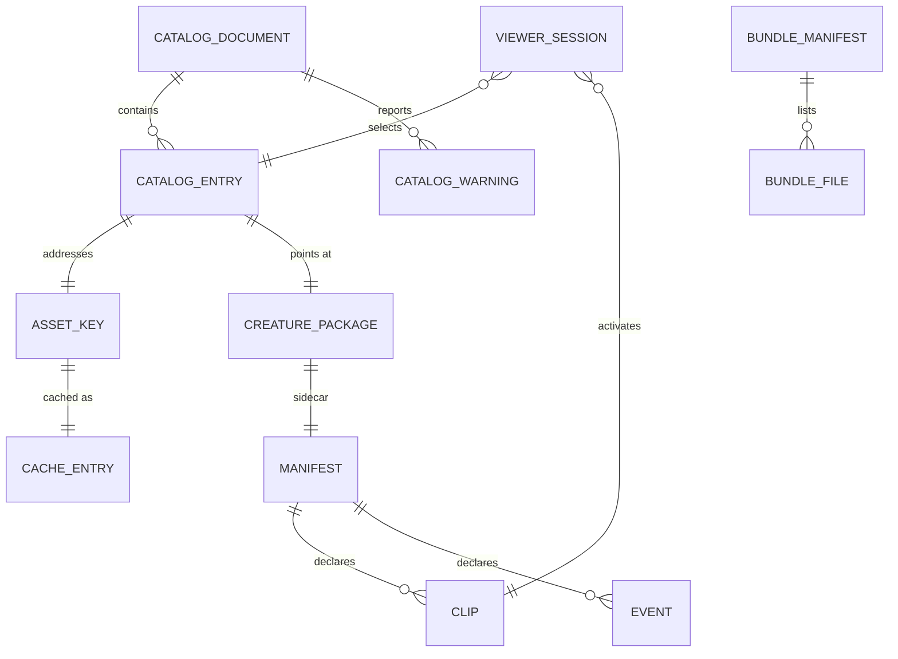

# Phase 1 Data Model: WebGL Library Viewer

**Feature**: `002-webgl-library-viewer` | **Date**: 2026-11-15
**Inputs**: [spec.md](./spec.md), [research.md](./research.md), ADRs 261115-5/6,
and the existing manifest model in `src/beastforge/model/manifest.py`.

This model is deliberately small. The viewer owns only **discovery and delivery**
data; every creature fact remains in the existing sidecar manifest, which is the
authoritative gameplay contract (ADR 261114-1). Nothing in this model may
duplicate or contradict a manifest value.

---

## 1. Entity map



---

## 2. CatalogDocument

The versioned, canonical index of every loadable recipe plus the metadata the
viewer needs. Produced by `viewer/catalog.py` from the library scan; consumed by
the frontend and by the export writer.

| Field | Type | Required | Rules |
|-------|------|----------|-------|
| `schemaVersion` | string | yes | `"1.0"`; `MAJOR.MINOR`. Additive fields bump MINOR; breaking changes bump MAJOR. |
| `toolVersion` | string | yes | `beastforge.__version__`; no timestamps/build metadata. |
| `generatedBy` | string | yes | Constant `"beastforge"`. |
| `categories` | array of `Category` | yes | Canonical order `["boss","quadruped","swarm","other"]`, filtered to categories present in `creatures`; unique. |
| `creatures` | array of [CatalogEntry](#3-catalogentry) | yes | One per **loadable** recipe; sorted by `name`; names unique. |
| `warnings` | array of [CatalogWarning](#4-catalogwarning) | yes | Sorted by `path`; may be empty. |

**Invariants**

- **Coverage (FR-018)**: the set of `creatures[].name` equals the set of recipes
  that `library.scan_with_warnings` can load. A recipe that fails to parse appears
  only in `warnings`.
- **No contradiction (FR-007/FR-018)**: for every entry, `name`, `category`, and
  `description` equal `manifest.creature.{name,category,description}` for the
  generated package. `recipeSha256` equals
  `manifest.provenance.recipeSha256`.
- **Relative references (FR-017)**: `asset` and `manifest` are document-relative
  paths, never absolute or host-qualified. Both modes serve the same values.
- **Determinism (FR-016)**: serialized with `canonical_json`; array order as
  above; no timestamps, hostnames, locale formatting, or unseeded values.
- **Tolerance (FR-009)**: the frontend ignores unknown top-level fields and
  unknown entry fields; a different major `schemaVersion` is rejected with an
  explicit message.

---

## 3. CatalogEntry

One loadable library creature as the gallery sees it. It is a **projection**, not
a stored duplicate.

| Field | Type | Required | Rules / source |
|-------|------|----------|----------------|
| `name` | string | yes | `recipe.meta.name`; matches `^[a-z0-9](?:[a-z0-9._-]*[a-z0-9])?$`. |
| `category` | enum | yes | `boss \| quadruped \| swarm \| other` from `recipe.meta.category`. |
| `description` | string | yes | Non-empty; `recipe.meta.description`. |
| `tags` | array of string | yes | `recipe.meta.tags`, declaration order preserved (recipe-authored, deterministic). |
| `recipeVersion` | string | yes | `recipe.meta.version`. |
| `testedWith` | string | yes | `recipe.meta.tested_with`. |
| `recipeSha256` | string | yes | 64 lowercase hex; `recipe_digest(parsed_document)`. Same value the manifest records. |
| `asset` | string | yes | `creatures/<name>/<recipeSha256>/<name>.glb`. |
| `manifest` | string | yes | `creatures/<name>/<recipeSha256>/<name>.manifest.json`. |

**Derivation**: extend `library.load_entry` with a helper that also returns the
parsed YAML document (and therefore the digest), without adding fields to the
existing `list --json` payload. `LibraryEntry.to_json()` and its closed schema
stay unchanged.

**Validation**

- `name` must equal the recipe file stem (existing loader rule).
- `recipeSha256` must be stable across formatting-only YAML changes
  (`recipe_digest` uses canonical JSON).
- `asset`/`manifest` must be derivable from `name` + `recipeSha256` only; no
  query strings, fragments, or absolute paths.

---

## 4. CatalogWarning

A non-fatal problem found while scanning, so the rest of the gallery still
works (FR-010).

| Field | Type | Required | Rules |
|-------|------|----------|-------|
| `path` | string | yes | Project-relative recipe path (`library/...`), never absolute. |
| `message` | string | yes | Stable, actionable text from the loader/gate. |

Warnings are sorted by `path`. A failing recipe never appears in `creatures`, so
the catalog cannot advertise an asset that cannot exist. The local card/stage
surface turns a generation-time failure into an inline error for that creature
only.

---

## 5. AssetKey and CacheEntry

**AssetKey** is the identity of one generated package:

| Field | Type | Rules |
|-------|------|-------|
| `name` | string | Catalog entry name. |
| `recipeSha256` | string | Current recipe digest. |

**CacheEntry** is the local materialization:

| Field | Type | Rules |
|-------|------|-------|
| `key` | AssetKey | — |
| `directory` | path | `<cache_root>/<name>/<recipeSha256>/`. |
| `glb` | path | `<directory>/<name>.glb`. |
| `manifest` | path | `<directory>/<name>.manifest.json`. |
| `state` | enum | `absent \| generating \| ready \| failed` (in-memory only). |

**Invariants**

- A `ready` entry contains both files and the manifest's
  `provenance.recipeSha256` equals the key.
- A cache hit never runs the generator.
- A recipe change produces a different key; the old entry becomes unreachable
  from the catalog but is not deleted automatically (disposable cache).
- The cache directory is outside tracked repository content by default and is
  never a source of truth (FR-013).
- Concurrent `ensure` calls for the same key perform at most one generation.
  Generation is serialized globally (one render at a time); cached assets are
  served concurrently. Requests for other keys queue and do not corrupt state.

**State transitions**

```text
absent --ensure--> generating --success--> ready
                         |
                         +--failure--> failed --ensure(retry)--> generating
ready --recipe changes (new key)--> absent (for the new key)
```

A failure leaves no final entry and does not poison other keys.

---

## 6. CreaturePackage and manifest projections

A **CreaturePackage** is the existing `.glb` + `.manifest.json` pair produced by
`beastforge.render`. The viewer treats it as read-only.

The viewer consumes these **manifest projections** (no new data, just typed
accessors):

### Clip

| Field | Type | Rules |
|-------|------|-------|
| `name` | string | Matches a `gltf.animations[].name`. |
| `duration` | number | Seconds, > 0. |
| `loop` | boolean | Playback intent; glTF carries no loop flag. |
| `generator` | string | Generator name from the closed registry. |

### Event

| Field | Type | Rules |
|-------|------|-------|
| `clip` | string | Must equal a declared clip name. |
| `time` | number | Seconds, `0 <= time <= clip.duration`. |
| `name` | string | Stable event name; the timeline label. |

### Manifest fact

Any inspector-visible value from the manifest: creature, provenance, units,
axes, bounds, suggested scale, skeleton root/joints, sockets, volumes, phases,
materials, playback, budgets. Displayed verbatim; missing optional fields render
as "not declared"; unknown fields are ignored for behaviour and shown in a raw
view.

**Invariants**

- The viewer never derives event timing from baked keyframes (ADR 261114-4).
- The viewer never changes `suggestedScale` semantics: it is a uniform hint.
- A different major `schemaVersion` disables manifest-based features with the
  standard compatibility message; same major + unknown fields works normally.

---

## 7. BundleManifest and BundleFile

`bundle.json` records the static export for determinism verification and CI. It
is not a viewer input.

### BundleManifest

| Field | Type | Required | Rules |
|-------|------|----------|-------|
| `schemaVersion` | string | yes | `"1"` (this is a build artifact, not the catalog contract). |
| `toolVersion` | string | yes | Same source as the catalog. |
| `files` | array of BundleFile | yes | Sorted by `path`; every emitted file except `bundle.json` exactly once; no directories. |

### BundleFile

| Field | Type | Required | Rules |
|-------|------|----------|-------|
| `path` | string | yes | POSIX-style document-relative path (`/` separators). |
| `sha256` | string | yes | 64 lowercase hex of the file bytes. |
| `bytes` | integer | yes | `>= 0`; exact byte length. |

**Invariants**

- The `files` list covers `index.html`, everything under `assets/`,
  `catalog.json`, and every `creatures/<name>/<sha>/...` file. It excludes
  `bundle.json` itself (a file cannot contain its own stable hash); that exclusion
  is normative in `contracts/bundle.schema.json`.
- Two exports of the same recipes and tool version produce identical
  `catalog.json`, identical `bundle.json`, and identical bytes for every listed
  file.

---

## 8. ViewerSession (client state)

Recoverable from the URL; no server persistence.

| Field | Type | Source | Rules |
|-------|------|--------|-------|
| `view` | enum | hash presence | `gallery` when no hash; `stage` when `#/<creature>/<clip>` is valid. |
| `creature` | string \| null | hash | Catalog entry name; unknown → gallery + toast. |
| `clip` | string \| null | hash | Manifest clip name; unknown → first clip + toast. |
| `category` | string \| null | query `category` | Must be in `catalog.categories`; unknown → all + toast. |
| `query` | string | query `q` | Free text over name + description (and tags, documented). |
| `camera` | derived | stage | Auto-framed from manifest bounds; orbit state is in-memory only, not a deep-link field. |

**State transitions**

```text
gallery --select card--> stage(creature, default clip)
stage --switch clip--> stage(creature, clip)          (replaceState)
stage --back / clear hash--> gallery                  (filters preserved)
gallery --type/filter--> gallery(filtered | empty)    (replaceState)
any --invalid deep link--> gallery or default clip + toast
any --WebGL failure--> same view + "3D unavailable" banner
```

**Invariants**

- A valid deep link restores the exact creature and clip with no extra action
  (FR-008, SC-005).
- Filters survive reload via the query string; the empty state is explicit.
- Back from the stage returns to the gallery, not through every clip switch.

---

## 9. Command reports (`view --json`)

### ServeReport

| Field | Type | Rules |
|-------|------|-------|
| `schema_version` | const `"1"` | CLI report version. |
| `tool_version` | string | `beastforge.__version__`. |
| `status` | const `"ok"` | Emitted once the socket is bound. |
| `mode` | const `"serve"` | — |
| `url` | string \| null | `http://127.0.0.1:<port>/`; loopback only. `null` under `--dry-run` (nothing is bound). |
| `cache_dir` | string | Absolute resolved cache path. |
| `dry_run` | boolean | `true` only for `--dry-run`. |

Emitted once; the process keeps serving and writes progress/diagnostics to
stderr.

### ExportReport

| Field | Type | Rules |
|-------|------|-------|
| `schema_version` | const `"1"` | — |
| `tool_version` | string | — |
| `status` | const `"ok"` | — |
| `mode` | const `"export"` | — |
| `output` | string | Absolute or caller-relative target path. |
| `creatures` | array of string | Exported names, sorted. |
| `files` | integer | Count of emitted files excluding `bundle.json`. |
| `warnings` | array of string | Scan warnings, sorted. |
| `dry_run` | boolean | `true` only for `--dry-run`. |

A failed export emits the standard error payload and exits non-zero; no partial
bundle remains.

---

## 10. Validation rules traced to requirements

| Rule | Source |
|------|--------|
| Exactly one catalog entry per loadable recipe | FR-001, FR-018, SC-002 |
| Entry fields equal manifest creature facts | FR-007, FR-018, SC-002 |
| Category filter and text search over name/description | FR-002, US1 |
| Live thumbnail without opening the creature | FR-003, US1 |
| Stage orbits/zooms and auto-frames from manifest bounds | FR-004, US2 |
| Every declared clip is listed and playable | FR-005, SC-003 |
| Event marks at declared times with declared names | FR-006, SC-003 |
| Inspector tabs never contradict the manifest | FR-007 |
| Deep link restores creature + clip | FR-008, SC-005 |
| Unknown manifest fields tolerated | FR-009 |
| Per-recipe problems are non-fatal warnings | FR-010 |
| One command starts the viewer, opens a browser, reports stop | FR-011 |
| Missing asset generated on demand; cached assets reused; stale recipes invalidated | FR-012 |
| Cache outside tracked content; no tracked-file writes | FR-013 |
| Loopback-only local server | FR-014 |
| One export command produces a self-contained bundle | FR-015 |
| Byte-identical export for identical inputs | FR-016, SC-004 |
| Both modes serve the same relative catalog | FR-017 |
| Catalog covers every loadable recipe and agrees with manifests | FR-018 |
| CI rebuilds/publishes on recipe or viewer change; no committed binaries | FR-019, SC-008 |
| Automated catalog contract + determinism checks | FR-020 |
| Opt-in browser smoke; default run offline/fast | FR-021, SC-009/SC-010 |
| Zero runtime external requests; no extra toolchain/build step | FR-022, SC-007 |
